# Assignment #6

Name: Ilya Koval
Group: SE-2539
GitHub Pages: <https://anommanager.github.io/web-assignment6/>

## Part 1

### Task 0

jQuery 3.7.1 is loaded via CDN and script.js is attached with defer. There is a ready handler that outputs text to the console.

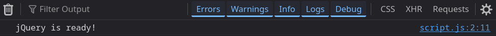

### Task 1

Create a section with your name, a headline and information.

There should be a profile section with a headline, e.g. "Welcome to My Portfolio".

Use tag, ID and class selectors. Change the greeting/headline with .text()/.html(). Change the styling with .css(). Add buttons to switch between light/dark themes.

There is a section with my name (#greeting), headline (#headline) and my Welcome to My Portfolio section with some information. The change text button uses .text() to change the greeting. The Light/Dark theme button toggles a boolean and uses .css() to change the color and background-color of the body.

Initial page:

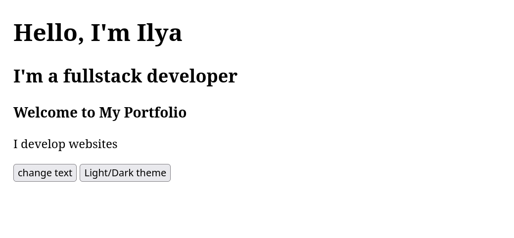

After clicking change text:

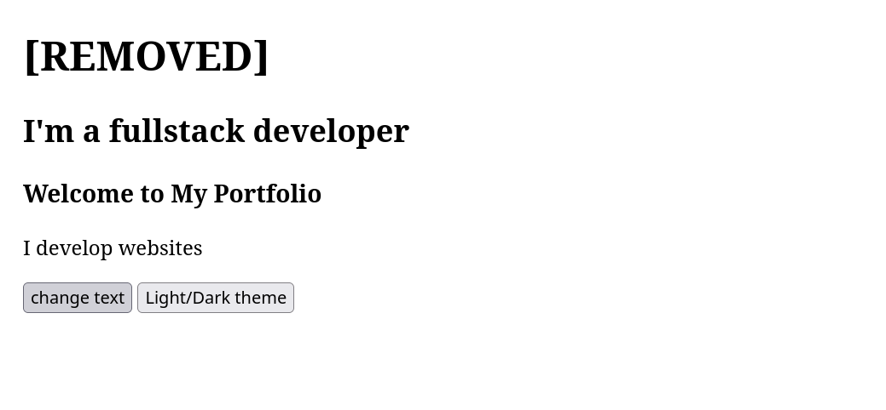

After clicking Light/Dark theme:

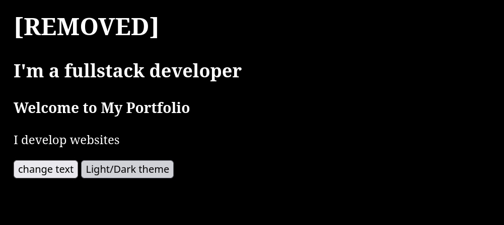

## Part 2

### Task 2

Create an About Me section.

Include a short bio, current status message, e.g. Currently learning jQuery!

Include a few fun facts. Add 3 buttons to hide/show/toggle the status message/fun facts.

The buttons use .hide(), .show(), .toggle() on #status, #funFacts.

Visible:

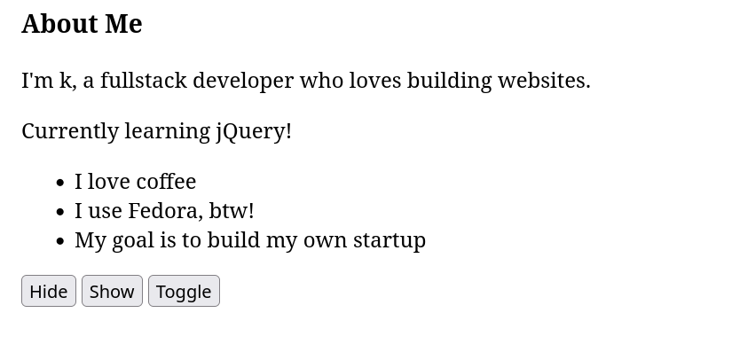

After clicking Hide:

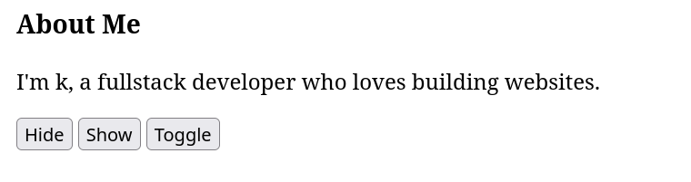

### Task 3

Show at least 2 images (profile picture, favourite hobby, travel images, personal projects etc.) Use .fadeIn(), .fadeOut(), .fadeToggle() to show/hide the images in the gallery.

There are 2 images in the gallery (Eiffel Tower and Notre-Dame). The buttons use .fadeIn(), .fadeOut(), .fadeToggle() on .gallery-img.

Shown:
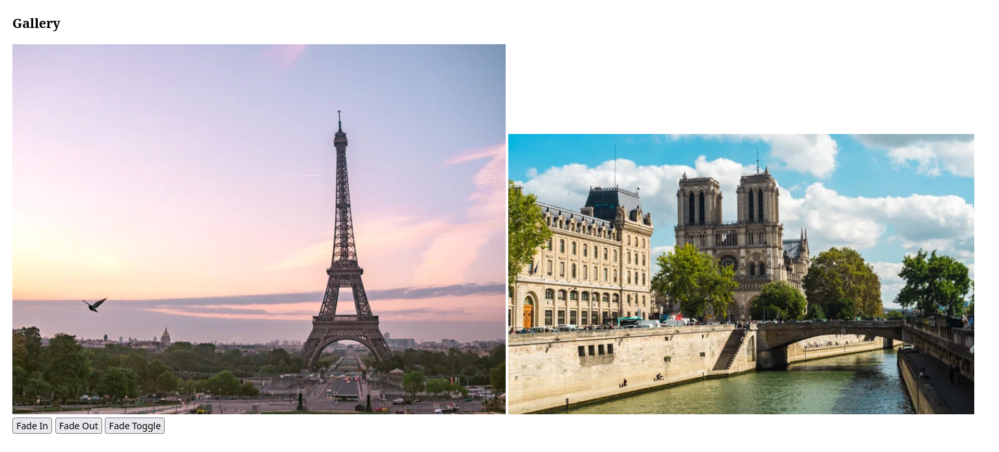

Faded:
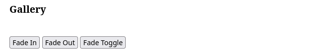

### Task 4

Create at least 3 headings that can be clicked. E.g. My Favorite Music, My Favorite Movie, My Favorite Subject.

Underneath the heading add a section with information related to the heading. Use .slideUp(), .slideDown(), .slideToggle().

There are 3 headings (.panel-title) with hidden panels (.panel) underneath. When clicking on the heading, $(this).next(".panel").slideToggle() is called, which smoothly opens/closes only the panel related to that heading.

Closed:
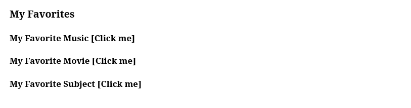 -->

Open:
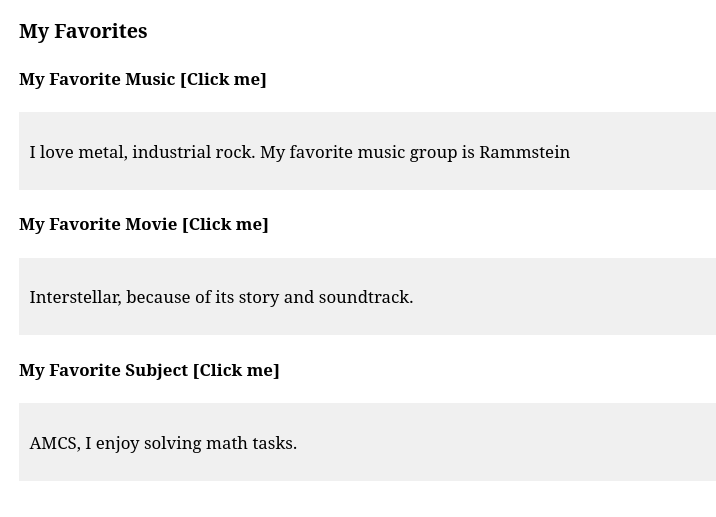

## Part 3

### Task 5

Show a list with at least 4 technical skills. Add a text input box for users to type in their skill. Add 3 buttons: Add Skill, Prepend Skill, Remove Skill. Use .append(), .prepend(), .remove(). Ensure nothing is added if empty.

Start with 4 skills. getSkill() uses .val().trim() to get the value from the input. If empty, alert is shown. Add Skill uses .append(), Prepend Skill uses .prepend(), Remove Skill uses .remove() on the last item. New is created using .text() so any HTML the user types in isn't interpreted.

### Task 6

Add a link to a social media platform (GitHub, LinkedIn, Personal Website etc.). Add a button to change the link dynamically using .attr().

Initially the link goes to my GitHub profile. When clicking Change Link, the href is changed using .attr(), text is changed using .text() and button text is changed.

Before:

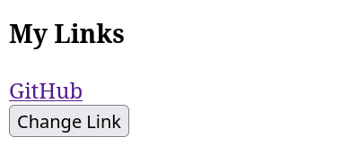

After:

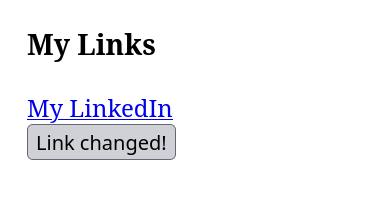

### Task 7

Create a form with Name and Email fields. As the user types, show what they have typed using .val() and .text().

Both fields use .on("input") to listen for input. Everytime the text changes, .val() is used to get the value from the field, then .text() is used to put it in the Live Preview section.

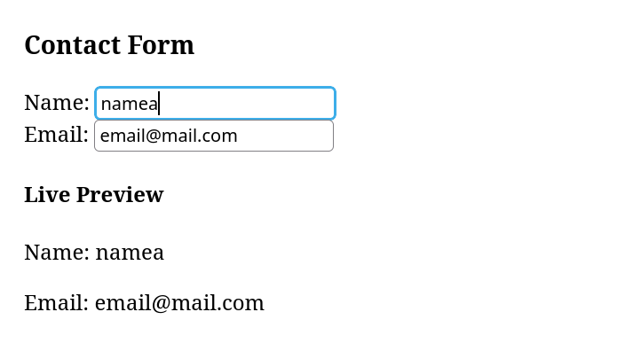

## Part 4

### Task 8

Expand on Task 5. Create a visual representation of at least 3 technical skills using skill bars. Add a button to animate my skills. Initially the bars should have a width of 0. When the button is clicked, use jQuery's .animate() function to increase the width of each bar. Set different widths for each bar to represent different skill levels. When the button is clicked again, animate the bars back to 0 width.

Each skill in the list from Task 5 has a bar (.bar) with a width of 0 in the CSS. Each bar has a skill level in data-level attribute. When the button is clicked for the first time, .each() is used to loop through each bar and .animate() is called with the width set to the level + "%". When the button is clicked again, all bars are animated back to 0. This is stored in the skillsShown variable. .stop() is used to stop any animations from building up if the button is clicked quickly. Any skills added by the user will also have a bar with a random level.

After clicking Animate My Skills (button now says Reset Skills):

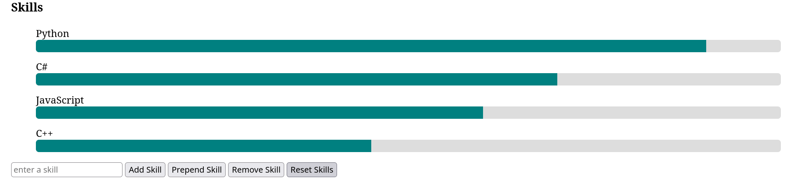

## Summary

I created the portfolio page step-by-step, adding each section to the index.html file. jQuery was added from the CDN and checked with the console. All sections were added to a single $(function () { ... }) block. Theme switching, text change, show/hide/toggle, fade, slide, list manipulation, changing link attributes, live preview and skill bar animation were all added.

A common issue I had was using the wrong selector. I had an ID on my button but was using a class to select it (button.changeText instead of #changeText). I learnt to make sure I use the correct # or . and to check the console for errors. I learnt that using $(this).next() allows me to have a single handler for multiple elements. Any elements that are dynamically created should be created using jQuery (.text(), .data()) so they act the same as the original ones. In Task 8, I expanded on the skills list from Task 5 so any new skills would have a bar.
